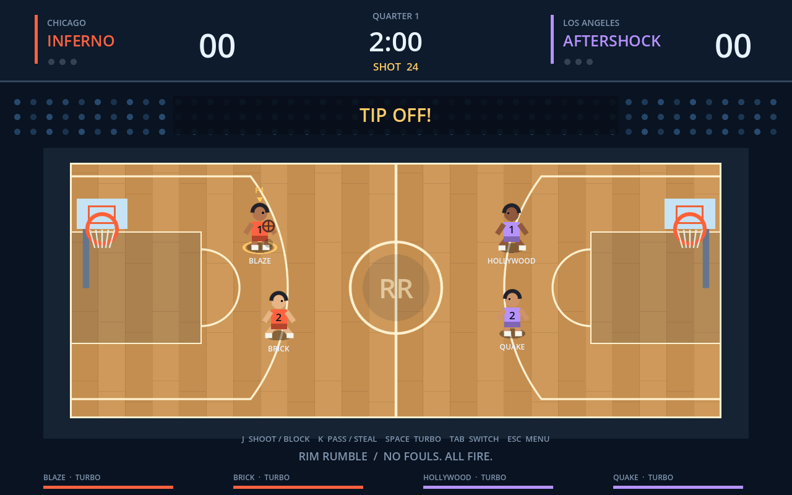

# Rim Rumble

An original Godot 4.5 arcade basketball game inspired by the pace and three-button controls of NBA Jam. The project contains all source, a true 3D arena with procedural meshes and textures, and synthesized sound; no asset downloads or addons are required.

## Run

Import `project.godot` in **Godot 4.5.1 or newer 4.x**, then press **F6/F5** to play. From a terminal:

```powershell
godot --path E:/github/jam_game
```

A Windows convenience launcher is included: `./play.ps1 -Godot 'C:/path/to/godot.exe'`. No exported executable or Godot engine binary is checked into Git.

## 3D arena

The court is a rectangular 28 × 15 mesh with a repeating, staggered hardwood plank texture, painted keys, regulation-style markings, and an elevated sideline perspective camera. Both baskets have modeled poles, padded bases, bracing, transparent framed backboards, orange rims, and tapered string nets.

Four low-poly humanoids wear team jerseys and use the native HY-Motion/SMPL-H skeleton (52 joints, 22 animated body joints). Their ten motion clips were generated locally with the standard HY-Motion 1.0 model. Running, jumping, shooting, dunks, stuns, and dribbling are presented from the existing match state. Controlled-player rings, name tags, shot meters, fire effects, and Big Head mode remain available. The crowd consists of 464 camera-facing billboard spectators, drawn with one MultiMesh and an animated four-frame cheering atlas with eight spectator variants.

The 3D presentation uses the same controls and simulation coordinates as the initial game. Arcade rule refinements are documented in [the research log](docs/ARCADE_RESEARCH.md). Clients' smoothed network positions feed the 3D models. The scoreboard, menus, and control hints retain their existing layout. All geometry, hardwood, and crowd artwork are generated locally; no external assets are needed.



## HY-Motion player animations

The shipped player clips are actual machine-generated outputs of a local **Tencent HY-Motion 1.0 standard (1B)** run: idle, run, dribble, defense, shoot, pass, dunk, block, steal, and stun/recovery. Each player has a Godot `Skeleton3D` whose bone names, hierarchy, and rest transforms match HY-Motion's official 52-joint SMPL-H skeleton. The model generates the first 22 body rotations; the 30 finger joints remain in their native rest pose.

The animation layer preserves the existing controls and basketball simulation. Model-generated joint rotations blend between gameplay actions; the simulation continues to own horizontal movement and arcade jump height. Peak wrist poses are aligned to shot/block/dunk timing. Generated clips and source metadata are committed under `animations/hy_motion/`; the large weights and Python environment remain in ignored `.runtime/` storage. **Playing the game does not require Python, CUDA, or model downloads.**

See [generation and rig details](docs/HY_MOTION.md), [recorded provenance](animations/hy_motion/provenance.json), and [the animation preview](docs/hy_motion_preview.gif). To regenerate on this Windows machine:

```powershell
.\tools\setup_hy_motion.ps1 -Python 'C:/Users/JasonGauci/miniconda3/python.exe'
# Re-export the cached model outputs after changing conversion/loop rules:
.\.runtime\venv\Scripts\python.exe .\tools\generate_hy_motion.py --phase export
```

## Play modes

- Quick Play: one human with a CPU teammate against two CPU opponents.
- Local Versus: two humans on opposite teams, with CPU teammates; keyboard or two gamepads.
- Arcade Ladder: defeat each of the other seven teams to earn a championship.
- Network Play: a host and up to three clients, with CPU players in vacant slots. The first client plays the opposing side; subsequent clients fill the home and away teammate slots.

Eight fictional teams feature sixteen athletes with different speed, shooting, dunking, and defense ratings. Big Head and Infinite Turbo house rules are available in Options. Quarter length and CPU difficulty are configurable. Initials, win/loss records, best score, and championships persist locally in Godot's `user://records.cfg`.

## Controls

| Action | Player 1 / any network player | Player 2, local versus | Gamepad |
| --- | --- | --- | --- |
| Move | WASD | Arrow keys | Left stick |
| Shoot / block | J | Numpad 1 | A |
| Pass / steal | K | Numpad 2 | X |
| Turbo | Space | Numpad 0 | RB or RT |
| Switch athlete (offline) | Tab | Numpad 3 | LB |
| Pause (offline) / leave overlay (online) | Escape | Escape | Keyboard Escape |
| Toggle sound | M | M | Keyboard M |

Hold Shoot and release when the shot meter reaches its center mark (about 0.58 seconds). Release timing, athlete ratings, distance, and defensive pressure affect jump shots. Turbo + Shoot near the attacking rim attempts a high-flying dunk. Turbo + Pass to a teammate near the rim throws an alley-oop. Pass steals on defense; Turbo + Pass shoves the ball carrier. Shoot jumps to block early shot releases. Missed shots become loose balls for rebounds. When your CPU teammate owns the ball, Pass requests a pass back and holding/releasing Shoot orders their shot. Another human teammate keeps control of their own actions.

Three consecutive unanswered baskets by one athlete ignite Fire for that athlete, improving shots and granting unlimited turbo. Fire survives misses and teammate baskets; an opponent's natural basket ends it. Before ignition, a miss or another scorer's basket resets the heating sequence. Descending shot contact near the rim awards goaltending points; the burning defender can legally block that shot. Goaltending points do not change heat. These edge rules remain subject to original-cabinet footage verification. There are two- and three-point baskets, a 24-second shot clock, four three-minute quarters by default, a halftime side switch, shots allowed to finish after the buzzer, and repeated overtime for ties. Postgame statistics include points, field goals, dunks, steals, blocks, rebounds, and goaltends (GT). No fouls or free throws.

## Network multiplayer

1. Host chooses Network Play → Host Game.
2. Clients enter the host's LAN IP and connect. Use `127.0.0.1` for multiple instances on one computer.
3. The first human on each side selects its team. Clients press Toggle Ready; the host starts the game once everyone is ready.
4. For internet play, forward **UDP 27888** to the host and allow the game through the host firewall. Direct-IP internet connections depend on router/NAT configuration. There is no matchmaking, NAT traversal service, or relay.

Each network human controls a fixed athlete using player-one controls. Disconnected clients are replaced with CPU players. The host can start a rematch from the results screen. Late joining and host migration are not supported; host departure ends the session.

The host simulates gameplay at 60 Hz and accepts only bounded input commands tied to the sender's assigned athlete. Shot/pass/team readiness messages and round starts use Godot RPCs; pass button events are reliable. Compressed state snapshots use ordered unreliable delivery at 20 Hz. Clients never submit scores or authoritative player positions. This is a direct-IP prototype, with no accounts, authentication, rollback, or competitive anticheat.

## Tests

```powershell
./tests/run.ps1 -Godot 'C:/path/to/Godot_v4.5.1-stable_win64_console.exe'
# Include actual GPU rendering and screenshots of the UI screens:
./tests/run.ps1 -Godot 'C:/path/to/Godot_v4.5.1-stable_win64_console.exe' -Capture
```

The arcade-rules suite checks individual heat, fire turbo, legal blocks, CPU shot blocking, goaltending, teammate orders and snapshot restoration. The HY-Motion suite checks the exact skeleton, quaternion validity, actual motion variation, native FK parity, action selection, and simulation immutability. The 3D suite checks geometry, floor tiling, articulated poses, modeled baskets, crowd instancing, camera framing, interpolation, and simulation immutability. GPU capture checks that the crowd pixels animate, and captures dunk/fire and Big Head poses. The simulation suite checks turbo, shot release, scoring, fire, alley-oops, blocks, rebounds, steals/shoves, halftime, overtime, snapshot restoration, and a complete CPU match. The networking test starts four real Godot processes and checks slot assignment, team selection, readiness, authoritative snapshots including fire/goaltend state, and disconnection. Render smoke tests exercise menus, selection, gameplay, options, help, network setup, lobby, and results. Screenshots and logs are generated under `tests/` and ignored by Git.

Tested with official Godot 4.5.1 on Windows; network tests use loopback. Public-internet latency, packet loss, real gamepad hardware, other operating systems, and exported builds have not been validated.

## Scope and remaining work

This is a playable original prototype, **not feature-for-feature NBA Jam arcade parity**. It uses original low-poly 3D art, an elevated sideline camera, and fictional teams, rather than licensed NBA rosters, digitized sprites, or original audio. Not included: all historical rosters and secret characters, substitutions, arcade cabinet credit/service/DIP-switch emulation, licensed commentary and music, original animation/collision fidelity, attract/replay sequences, backboard destruction, online matchmaking, controller-only menus, remappable controls, and production-quality network prediction/reconnection. Tuning and extended human playtesting remain necessary.

## Source map

- `scripts/main.gd`: menu flow, local inputs, HUD, sound, saved records, arcade ladder.
- `scripts/arena_3d.gd`: 3D arena, repeating hardwood, player action selection, baskets, billboard crowd shader/atlas, sideline camera, and ball presentation.
- `scripts/hy_motion_rig.gd`: exact SMPL-H Skeleton3D, bone-attached low-poly mesh, generated clip playback, blending and event timing.
- `tools/generate_hy_motion.py`: local text encoding, standard-model inference, native skeleton export, rotation conversion, loop selection, and provenance.
- `scripts/match_state.gd`: host/offline simulation, CPU behavior, basketball rules, snapshots.
- `scripts/network.gd`: ENet lobby, peer slots, readiness, validated inputs, state delivery.
- `scripts/teams.gd`: original teams and athlete ratings.

Godot networking references: [high-level multiplayer](https://docs.godotengine.org/en/4.5/tutorials/networking/high_level_multiplayer.html), [ENetMultiplayerPeer](https://docs.godotengine.org/en/4.5/classes/class_enetmultiplayerpeer.html).
