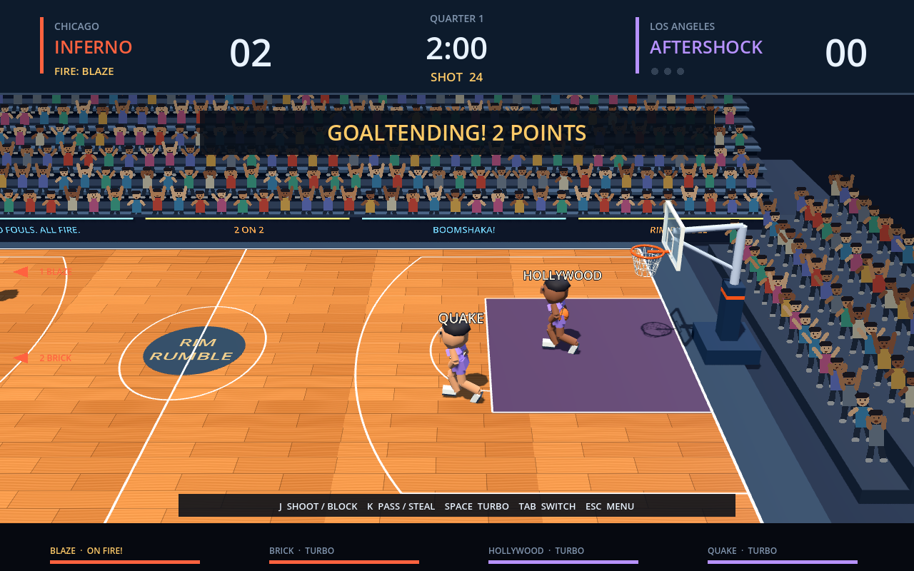
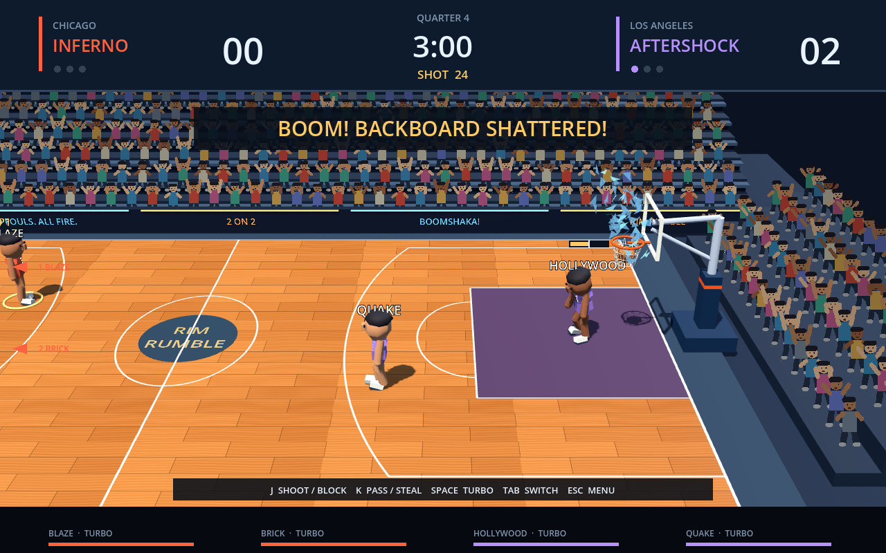

# Arcade research and implementation log

Target: the original 1993 NBA Jam arcade cabinet. Tournament Edition, console ports and later games are separate references. This project retains original fictional teams, 3D graphics and locally generated HY-Motion animation.

## Sources reviewed — 2026-10-18

- [Midway arcade operations manual](https://www.arcade-museum.com/manuals-videogames/N/NBAJam.pdf), PDF page 2, actual scanned instructions inspected. Confirms the three action buttons, turbo combinations, and that pressing Pass or Shoot orders a CPU teammate with possession to perform that action. This is the primary source for teammate commands. A research copy remains in ignored `.runtime/research/`; copyrighted scans are not shipped.
- [Museum of the Game arcade entry](https://www.arcade-museum.com/Videogame/nba-jam), gameplay and introduction read. Describes four three-minute quarters, individual three-basket fire, enhanced accuracy, unlimited personal turbo and immunity to goaltending. Opposing baskets end fire. Its unspecified computer-controlled fire timeout is not implemented without a reproducible trigger.
- [Fast Eddie's original-game FAQ](https://gamefaqs.gamespot.com/arcade/583605-nba-jam/faqs/748), indexed excerpts only; full-page access was restricted. Supports individual fire surviving misses and ending on an opponent's basket. The FAQ also covers ports, so platform-specific secrets are not assumed to apply to the cabinet.
- [Operation Sports retrospective](https://www.operationsports.com/throwback-thursday-nba-jam/), Elliott Jenkins, November 17, 2016, read. Useful qualitative evidence for the fast 2-on-2 feel, dunks, shoves, blocks and comeback assistance. It discusses several versions; its descriptions alone do not establish original-cabinet edge rules.
- [TKunka's Tournament Edition FAQ](https://gamefaqs.gamespot.com/arcade/583606-nba-jam-tournament-edition/faqs/749) and [Brian Sulpher's Tournament Edition FAQ](https://gamefaqs.gamespot.com/arcade/583606-nba-jam-tournament-edition/faqs/19427), indexed excerpts only. Corroborate goaltending/fire interactions for TE. They are explicitly weaker evidence for the original release.
- [How to WIN at NBA JAM!](https://www.mikesarcade.com/cgi-bin/spies.cgi?action=url&page=nba.jam.txt&type=info), Randolph S. Vance and William G. Henderson, version 1.13, August 18, 1993. Accessible original arcade FAQ archive read, including controls, techniques, fire, powerups and progression. Supports fourth-quarter/overtime specialty-dunk shattering, late dunk rejection and preserving a defender's existing heat while goaltending. It does not specify exact shatter probability or dunk counts.

## Implemented from this review

- Default quarters now last 3:00, with shorter house-rule options retained.
- Heat belongs to the individual scorer. Two consecutive baskets show Heating Up; three ignite Fire. Alternating teammate scores cannot combine into ignition. Only that athlete gets the accuracy boost, unlimited turbo, player flames and a flaming shot trail.
- Established fire survives misses and teammate baskets. An opponent's natural basket ends it. A miss resets a cold athlete's heating streak.
- Reachable ascending-shot contact is a block. Reachable descending contact close to the basket awards the shot's two or three points as goaltending, even if the simulated shot would miss. The defender gets the inbound; goaltends have their own GT statistic. The burning defender can legally reject such a shot.
- Off-ball Pass orders a CPU ball carrier to return the ball. Hold/release Shoot orders that teammate to shoot using the existing timing. A pass order cancels a CPU shot windup. Another human's input is never overridden.
- CPU defenders now recognize shots after ball ownership clears, attempt reachable legal blocks and avoid deliberately goaltending while cold. All new state travels in host snapshots.
- The original-game Fast Eddie FAQ's indexed Basic Moves/Special Techniques sections additionally describe tap-to-head-fake (CPU teammate orders still shoot) and passing during a dunk. Both are implemented. A human Shoot tap shorter than 0.16 seconds keeps possession and plays a partial generated shooting motion. A dunker can pass before 85% of flight, preserving the ball's position and elevation; the abandoned dunk does not count as a field-goal attempt. Blocked dunks cannot be cancelled.
- A closer sideline camera now follows possession smoothly, with clamped lateral travel, numbered/name-labelled off-screen arrows, a frozen view during pause and a full-court results overview. This follows the side-scrolling presentation described by the Museum entry. Framing and smoothing are original 3D design choices, not measurements from footage.
- Successful dunks in Q4/overtime now shatter the physical attacking backboard. The prototype uses the first made dunk per intact hoop, a 1.65-second clock-stopped spectacle, 70 deterministic triangular shards, a synthesized crash, camera impact and normal opposing inbound afterward. Glass/target markings remain absent until rematch; debris lands flat and fades after four to six seconds. Stored break timestamps reconstruct the effect on clients despite missed snapshots. This is an authored trigger and presentation, not a verified reproduction of a specific cabinet revision.
- Late contact on a held dunk is now a legal rejection for any defender. Only a descending released jump shot invokes the normal goaltending rule. This corrects the previous prototype's mistaken use of jump-shot goaltending for dunks; the GPU goaltending fixture now stages a released jumper.

## Fidelity limits and unresolved questions

These are implemented rules, not a claim of complete original-cabinet parity. The original 1993 archive now corroborates preserving a defender's existing heat through goaltending. Awarded points not advancing the shooter's ignition remain provisional, supported by TE descriptions. Exact original revision behavior needs footage or direct cabinet verification. The teammate-score handling before ignition also needs that check.

Contact uses the game's existing distance/height checks at the start of a block. It does not yet model hand-to-ball collisions throughout the jump. A blocked ball follows the existing flight/rebound path instead of a physical deflection. Head-fake duration and airborne-pass cutoff are authored tuning values; exact arcade timing and CPU reaction to fakes remain unverified. Hand-to-ball IK is still absent.

No video has been watched. Opening [the candidate arcade longplay](https://www.youtube.com/watch?v=jzQmf1edPkY) was denied by the browser access gate because origin access was declined. No download or alternate access was attempted. Video comparison remains pending until access changes or an authorized local video is available.

Next fidelity work: observe actual cabinet possession/camera and shot timings; verify fire edge rules and exact backboard-destruction triggers; implement tip-off and period transitions; improve moving dunk/layup selection, turbo pass speed, ball-contact/rebounds and CPU response to fakes; expand persistent arcade progression and attract/replay presentation. Console FAQs describe conflicting dunk-count triggers, so no exact original trigger is asserted. Original roster/secret-character completeness, cabinet credits/service settings, audio/commentary and production internet networking remain outside the current prototype's verified coverage.

## Verification

`tests/arcade_rules.gd` checks 43 rule and input scenarios, including CPU blocks, fire/goaltending, teammate release timing, head-fakes, airborne dishes, legal late dunk rejection and snapshot restoration. `tests/backboards.gd` checks 28 shattering/scoring/clock/visual reconstruction scenarios. The four-process network test additionally verifies individual fire, fake state and GT statistics on all three clients. A two-process test executes remote head-fake/dunk/pass input through the host, verifies the received dish, then drives a fourth-quarter shattering dunk through normal input and confirms the resulting inbound. Arena tests verify individual flame ownership, shot trails, camera tracking/pause/results behavior and off-screen indicators without mutating simulation state. GPU captures cover the help page, head-fakes, airborne dishes, individual fire/dunk, glass explosion/settling, results columns and animated crowd. See [validation](VALIDATION.md) for outcomes.

